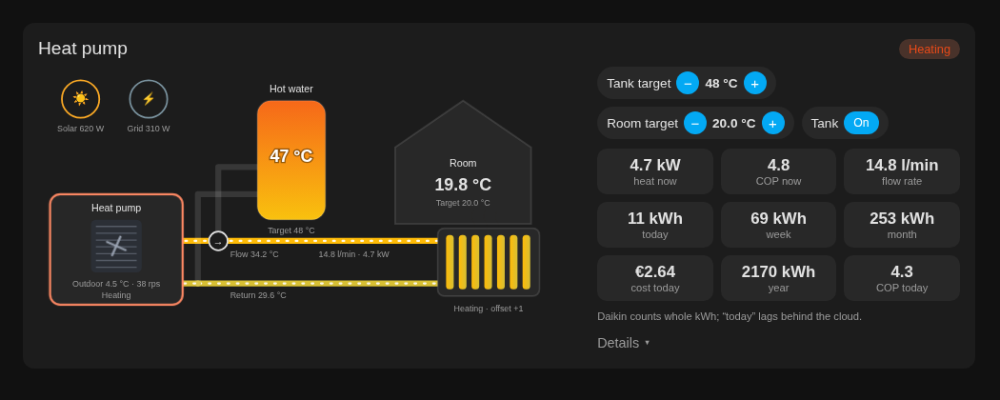
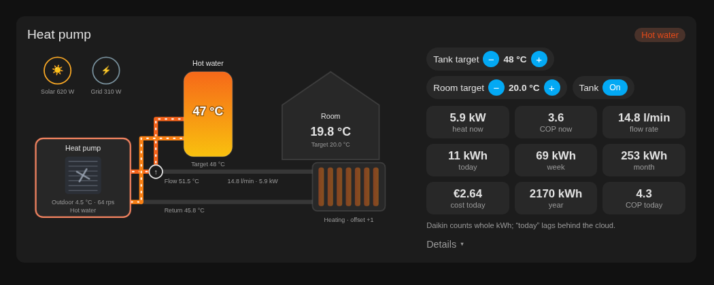
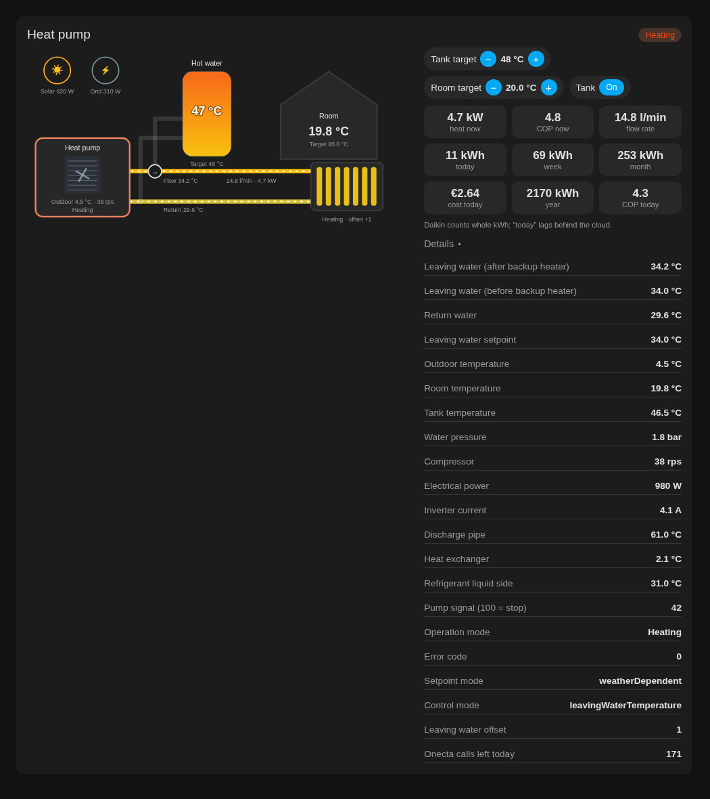

# daikin_flow_card

An animated Home Assistant card that shows what a **Daikin Altherma** heat pump is doing right now:
water flowing to the floor heating or to the hot water tank, live temperatures, heat output, COP,
energy use and costs. Buttons let you change the tank and room setpoints.





## What it shows

- **Flow diagram**: heat pump → 3-way valve → floor heating *or* hot water tank. Pipes are coloured by
  water temperature (blue = cold, orange-red = hot) and animate only where water actually flows.
- **Status**: heating, hot water, defrost, circulating, standby, fault; plus chips for the backup heater
  and boost mode.
- **Heat output** (kW), calculated as `flow (l/min) × (leaving − return) × 4.186 / 60`.
- **COP now**: heat output divided by electrical power (needs a power sensor, see below).
- **kWh** today / week / month / year from Daikin's own counters, and **cost today** if you add a price sensor.
- Optional **solar** and **grid** readings.
- A **Details** list with every raw value: refrigerant temperatures, water pressure, pump signal, error code…
- English or Dutch labels.



## What you need

| Source | Gives | Required? |
|---|---|---|
| [ESPHome Altherma](https://github.com/jjohnsen/esphome-altherma) (an ESP32 on the X10A connector) | live flow, supply/return temperature, compressor speed, defrost, valve position | strongly recommended |
| [Daikin Onecta](https://github.com/jwillemsen/daikin_onecta) integration (cloud) | controls (setpoints, tank on/off), kWh counters, fallback temperatures | yes |
| A power sensor for the heat pump (Shelly, CT clamp, or a template estimate) | COP | optional |
| An electricity price sensor (e.g. Tibber) | cost today | optional |

Without the ESP, the card still works: it guesses the activity from the Onecta temperatures and shows an
"inferred" chip.

## Install

**HACS** (custom repository):
1. HACS → ⋮ → *Custom repositories* → add `https://github.com/toldenburger/daikin_flow_card`, type *Dashboard*.
2. Install **Daikin flow card** and reload the browser.

**Manual**:
1. Copy `daikin-flow-card.js` to `config/www/`.
2. Settings → Dashboards → ⋮ → *Resources* → add `/local/daikin-flow-card.js` as a *JavaScript module*.

## Configure

The smallest config, if your entities have the default names:

```yaml
type: custom:daikin-flow-card
```

A fuller example:

```yaml
type: custom:daikin-flow-card
title: Heat pump
language: en                      # en or nl
price: sensor.electricity_price   # EUR/kWh
pv: sensor.solar_power            # W
grid: sensor.grid_import_power    # W
grid_export: sensor.grid_export_power
power_entity: sensor.heat_pump_power
power_is_estimate: true           # shows "≈" in front of the COP
cop_day: sensor.heat_pump_cop_today
esp:                              # only the ones whose names differ
  flow: sensor.my_altherma_flow_sensor_l_min
```

Every entity can be overridden. The defaults (Onecta device `altherma`, ESPHome device `altherma_esp`)
are at the top of [`daikin-flow-card.js`](daikin-flow-card.js). Clicking any value opens Home Assistant's
more-info dialog for that entity.

### No power meter? Estimate it

The ESP reports the inverter current. Current × 230 V × a correction factor is a fair estimate; add the
backup heater when it is on:

```yaml
template:
  - sensor:
      - name: Heat pump power (estimate)
        unit_of_measurement: W
        device_class: power
        state_class: measurement
        availability: "{{ states('sensor.altherma_esp_inv_primary_current_a') | is_number }}"
        state: >
          
          
          
          
          {{ p | round(0) }}
```

Tune `k` against a real meter if you can; the backup heater wattages depend on your model.

## Try it without Home Assistant

Open [`demo/index.html`](demo/index.html) in a browser. It feeds the card fake values and has buttons to
switch between heating, hot water, standby and defrost. Add `?lang=nl` for Dutch.

## Notes

- Daikin's kWh counters only count whole kWh and the cloud updates slowly, so "today" runs behind.
- Respects *reduce motion*: animations stop when the OS asks for that.
- One plain JavaScript file, no build step, no dependencies.

## License

MIT, see [LICENSE](LICENSE).

---

Made by Claude 🤖
